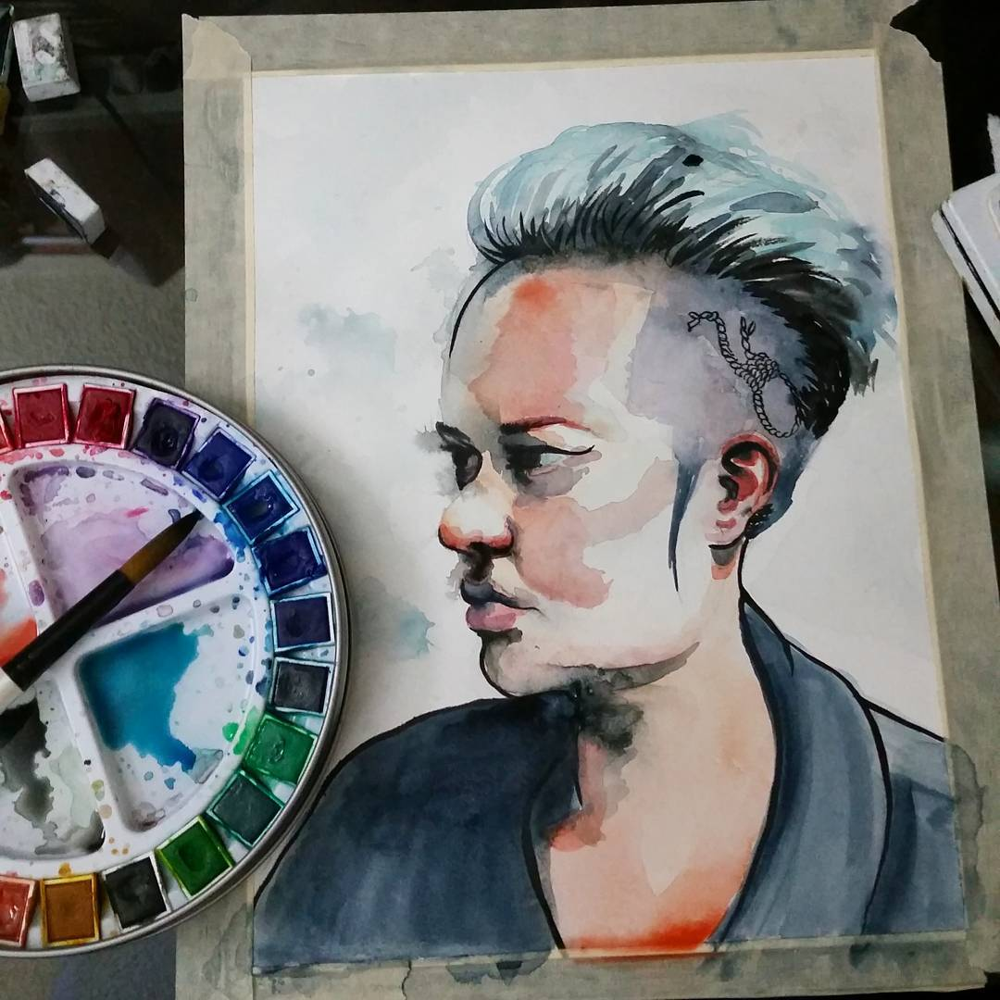

# shellyweasel.com

This folder is the whole website: a one-page artist home page for Shelly Weasel. It's live at **https://shellyweasel.com**.

The page has five parts, top to bottom:

1. **Loading screen.** Watercolor blooms spread across the paper while the page loads.
2. **Hero.** Your name beside the big painting (`images/hero.jpg`).
3. **About.** The short bio, plus four tiles for watercolor, gouache, oil and charcoal. Each tile shows one of your paintings and links to its Instagram post.
4. **From the studio.** Your 5 most recent Instagram posts.
5. **Say hello.** Contact links that open an Instagram direct message to you.

---

## How it all fits together

There are three parts, and each one has a single job:

```
 Your Mac                    GitHub                         GoDaddy
 ─────────                   ──────                         ───────
 This folder       ──push──▶  Stores the files and   ◀──────  Owns the name
 (where you edit)            serves them as a website       "shellyweasel.com" and
                             (GitHub Pages, free)           points it at GitHub
```

1. **Your Mac.** You edit the files here, in `Desktop/Shelly`.
2. **GitHub.** It keeps a copy of the files and puts them online for free. This is called GitHub Pages.
   - Account: **weaselshelly**
   - Files: https://github.com/weaselshelly/shellyweasel.com
3. **GoDaddy.** It only owns the domain name. Its DNS settings tell browsers that "shellyweasel.com" lives at GitHub. GoDaddy does **not** host the site.

When someone visits shellyweasel.com, GoDaddy sends them to GitHub, and GitHub shows them `index.html`.

---

## What's in this folder

| File | What it is | Safe to edit? |
|---|---|---|
| `index.html` | The page itself: all the text, layout, colors and animations | Yes |
| `images/hero.jpg` | The big painting at the top | Yes, swap it anytime |
| `images/medium-*.jpg` | The four medium tiles: `medium-watercolor.jpg`, `medium-gouache.jpg`, `medium-oil.jpg`, `medium-charcoal.jpg` | Yes, swap them anytime |
| `images/work-1.jpg` to `work-4.jpg` | Shown in the Instagram section until the live feed is connected | Yes |
| `instagram/` | Your 5 latest Instagram posts (`feed.json` plus images), saved automatically every 6 hours | No, it updates itself |
| `.github/` | The job that updates the Instagram feed (`workflows/instagram.yml`) and the script it runs (`scripts/instagram.mjs`) | Only if you know what you're changing |
| `README.md` | This guide | Yes |
| `CNAME` | One line that tells GitHub the site's name is shellyweasel.com | **No, leave it alone** |
| `.gitignore` | Tells git to skip Mac clutter files (`.DS_Store`) | No need to touch |
| `shelly weasel website/` | Your original hero image. It stays on your Mac and is **not** published. The site uses the copy in `images/`. | Yes |

> ⚠️ Don't delete or rename `CNAME`. Without it, shellyweasel.com stops working.

---

## Making changes

Open `index.html` in a text editor such as TextEdit, VS Code or BBEdit. To find something quickly, use **Cmd + F** to search for the words you see on the page. Change only the words between the `>` and `<` marks, then save.

### Change the bio
Search for `I'm Shelly Weasel`. The bio is three paragraphs, each wrapped in `<p ...>` and `</p>`:

```html
<p data-reveal style="--delay:.1s">I'm Shelly Weasel, a mixed-media artist …</p>
<p data-reveal style="--delay:.2s">Most of my work starts as an idea …</p>
<p data-reveal style="--delay:.3s">This site is home for finished pieces …</p>
```

The first paragraph shows in larger type, and the rest in smaller gray type. To add a paragraph, copy a whole `<p …>…</p>` line and change its text. The `--delay` number sets when it fades in, so keep them counting up.

### Change other text
| What | Search for |
|---|---|
| The line under your name at the top | `Paintings in watercolor, gouache and oil` |
| The small label above your name | `Painter &amp; portrait artist` (`&amp;` shows as "&") |
| The About headline | `A painter who` |
| The handwritten caption under the hero | `from the sketchbook` |
| A medium tile's short description | The medium's name, such as `Watercolor` |
| The Instagram section heading and intro | `Fresh off` and `Recent paintings` |
| The contact headline | `Commissions, questions` |

### Change the hero painting
Replace `images/hero.jpg` with another **square** JPG with the same name. Then search `index.html` for `images/hero.jpg` and update its `alt="..."` description. That's what screen readers read aloud.

### Change a medium tile
Each tile has three things to update. Here's the watercolor one:

```html
<a class="pan__well" href="https://www.instagram.com/p/BO-9WSFl8Pz/" …>
  
</a>
```

1. **The image:** replace `images/medium-watercolor.jpg` (or `-gouache`, `-oil`, `-charcoal`). The tile crops it to a 4:3 rectangle, so keep the subject near the middle.
2. **The link (`href`):** the Instagram post the tile opens. Open the post on Instagram and copy its address.
3. **The description (`alt`):** a short sentence describing the painting, for screen readers.

### How people contact you
The "just hello →" link and the "Message me" link in the footer open a direct message to **@shelly_weasel** on Instagram (`https://ig.me/m/shelly_weasel`). On phones it opens the Instagram app. On computers it opens Instagram on the web, where the visitor has to be logged in. No email address appears anywhere on the site.

Messages from people you don't follow usually land in **Message requests**, so check there too.

When you're logged in as @shelly_weasel and click the link yourself, you'll get a blank page, because Instagram won't open a chat with yourself. Visitors see a new message to you.

### Preview before publishing
Double-click `index.html` and it opens in your browser. Refresh the browser after each change. Nothing goes online until you publish.

When you preview this way, the Instagram section always shows the images in `images/`. Browsers don't let a page opened from your Mac read the saved feed. The live site will show your posts once the feed is connected.

---

## The Instagram feed

The "From the studio" section shows your **5 most recent** Instagram posts, straight from Instagram with no third-party service in between.

**How it works:** every 6 hours, a GitHub job (`.github/workflows/instagram.yml`) asks Instagram for your 5 newest posts. It saves them into the `instagram/` folder (`feed.json` plus the images) and republishes the site. If nothing's new, it does nothing. Instagram's image links expire after a few days, which is why the images are saved rather than linked. Hover over a post to see its caption, and click it to open the post.

### ✅ Status: connected (since Oct 28, 2026)
The Meta app **"Shelly Weasel Site Feed"** (developers.facebook.com → My Apps) reads @shelly_weasel's posts, and the `IG_ACCESS_TOKEN` secret is saved in GitHub.

⚠️ **The token expires after 60 days, around Dec 27, 2026**, unless it's renewed. To make it renew itself every Monday, finish step 4 below (`GH_PAT`). Otherwise, generate a new token in the Meta app before then and save it again.

### One-time setup (steps 1–3 and 5 done)
1. **Instagram:** make @shelly_weasel a **Creator** or **Business** account (Instagram → Settings → Account type and tools). It's free. Personal accounts can't use the Instagram API.
2. **Meta for Developers:** at https://developers.facebook.com, create an app with the **Instagram API** use case. Under **API setup with Instagram login**, add @shelly_weasel and click **Generate token**. The app can stay in development mode, since only you use it.
3. **Save the token to GitHub.** In Terminal, run the command below and paste the token when asked. It goes straight to GitHub and isn't shown on screen.
   ```bash
   gh secret set IG_ACCESS_TOKEN --repo weaselshelly/shellyweasel.com
   ```
4. **Automatic renewal.** Instagram tokens expire after 60 days, and this lets the job renew yours every Monday.
   1. At https://github.com/settings/personal-access-tokens, create a **fine-grained token**. Limit it to the `shellyweasel.com` repository and give it **Secrets: Read and write** permission.
   2. Run this command and paste the new token when asked:
   ```bash
   gh secret set GH_PAT --repo weaselshelly/shellyweasel.com
   ```
5. **Run it once now:** on the Actions page, pick **Update Instagram feed** and click **Run workflow**. Within a few minutes your posts appear on the site.

Both secrets live in GitHub at **Settings → Secrets and variables → Actions**:

| Secret | What it is |
|---|---|
| `IG_ACCESS_TOKEN` | Your Instagram access token. It lets the job read your posts. |
| `GH_PAT` | A GitHub token that lets the job renew `IG_ACCESS_TOKEN` every Monday |

### If the feed stops updating
Check the Actions page for a red ❌. The usual cause is an expired Instagram token. Generate a new one in your Meta app and save it again with the `gh secret set IG_ACCESS_TOKEN …` command above.

---

## Accessibility

The site is built to meet **WCAG 2.2 AA**, the usual standard for ADA compliance. Automated checks (axe, WAVE) found no errors at launch. Keep it that way when you make changes:

- **Every image needs a short `alt` description** of what it shows.
- **Keep text colors dark enough.** The colors are set once at the top of `index.html` (`--ink`, `--muted`, `--vermilion-ink`) and were chosen to pass. If you add colors, check them with WebAIM's contrast checker (https://webaim.org/resources/contrastchecker/). Normal text needs at least **4.5:1**.
- **Write colors as hex (`#625a52`) or `rgba(...)`.** WAVE can't read newer color formats such as `color-mix()`. It reports them as contrast errors even when the colors are fine.
- **Use the light red `--vermilion` only for decoration**, such as the brush-stroke underlines. For red text, use `--vermilion-ink`.
- **Animations:** visitors who turn on "Reduce motion" on their device see the page without animations.

To re-check, run the WAVE browser extension on https://shellyweasel.com. Automated tools catch only part of the problems, so also try the page using only the keyboard (Tab and Enter).

---

## Publishing your changes

### The easy way
Ask Claude Code: **"publish my site changes."**

### Doing it yourself
Open the Terminal app and run these commands, one at a time:

```bash
cd ~/Desktop/Shelly
git pull
git add -A
git commit -m "Describe what you changed"
git push
```

- `git pull` brings in anything changed on GitHub first, such as Instagram feed updates.
- `git add -A` gathers up every change.
- `git commit` saves a snapshot with a short note.
- `git push` uploads it to GitHub.

The live site updates about **1–2 minutes** after you push. If you don't see the change, refresh with **Cmd + Shift + R**.

To check whether the site has finished updating, go to https://github.com/weaselshelly/shellyweasel.com/actions. A green check ✅ next to "pages build and deployment" means it's live.

### Changing the Instagram job
GitHub only lets you push changes to `.github/workflows/` if your Terminal login has the **workflow** permission. Without it, `git push` fails with *"refusing to allow an OAuth App to create or update workflow"*. Either:
- run `gh auth refresh -h github.com -s workflow` once and approve it in the browser, or
- edit the file directly on github.com. Open it, click the ✏️ pencil, then click **Commit changes**.

---

## Domain settings (GoDaddy)

These are already set up, so you only need this section if something breaks. Find them at **GoDaddy → My Products → shellyweasel.com → DNS**.

| Type | Name | Value |
|---|---|---|
| A | @ | 185.199.108.153 |
| A | @ | 185.199.109.153 |
| A | @ | 185.199.110.153 |
| A | @ | 185.199.111.153 |
| CNAME | www | weaselshelly.github.io |

Leave all the other records alone (email, pay, ftp, NS, SOA, MX).

> ⚠️ **Don't press "Publish" in GoDaddy's Website Builder.** The old builder site is still in your GoDaddy account. Publishing it can point your domain back at the old site and replace the A records above.

---

## The padlock (HTTPS)

The site has a free security certificate from GitHub, which is what shows the padlock 🔒 in the browser. **Enforce HTTPS** is turned on, so visitors always get the secure version. To check it, go to https://github.com/weaselshelly/shellyweasel.com/settings/pages.

---

## If something goes wrong

| Problem | Try this |
|---|---|
| My change isn't showing | Wait 2 minutes, then refresh with Cmd + Shift + R. Check the Actions page for a green ✅. |
| `git push` says "rejected" or "fetch first" | Run `git pull`, then `git push` again. The Instagram job may have saved new posts since your last pull. |
| `git push` says "refusing to allow an OAuth App to … workflow" | See **Changing the Instagram job** above. |
| `git push` asks me to log in | In Terminal, run `gh auth login --web` and follow the steps. |
| GitHub emails me "Update Instagram feed failed" | The Instagram token has probably expired or is wrong. See **If the feed stops updating** above. |
| The Instagram section shows my old artwork instead of new posts | The feed isn't connected yet, or the job is failing. Check the Actions page. |
| A tile or image is a blank box | Check that the file name matches exactly, such as `medium-oil.jpg` (lowercase, `.jpg` not `.jpeg` or `.png`). |
| The site shows the old GoDaddy page | Check the DNS records above. Someone may have published the GoDaddy builder site. |
| The site shows a GitHub "404" page | Make sure `index.html` and `CNAME` are still in the folder and were pushed. |
| I broke the page and want the last version back | Run `git checkout -- index.html` in Terminal. This undoes changes since your last commit. |

---

## Accounts at a glance

- **GitHub:** username `weaselshelly`. It hosts the site and runs the Instagram feed job.
- **Instagram:** @shelly_weasel. It supplies the feed and receives contact messages. It must be a Creator or Business account for the feed.
- **Meta for Developers:** your app "Shelly Weasel Site Feed" gives the site permission to read your Instagram posts. It's free.
- **GoDaddy:** owns the domain shellyweasel.com and manages its DNS. You renew the domain here every year.
- **Cost:** GitHub Pages and the Instagram API are free. You pay only for the GoDaddy domain renewal.
